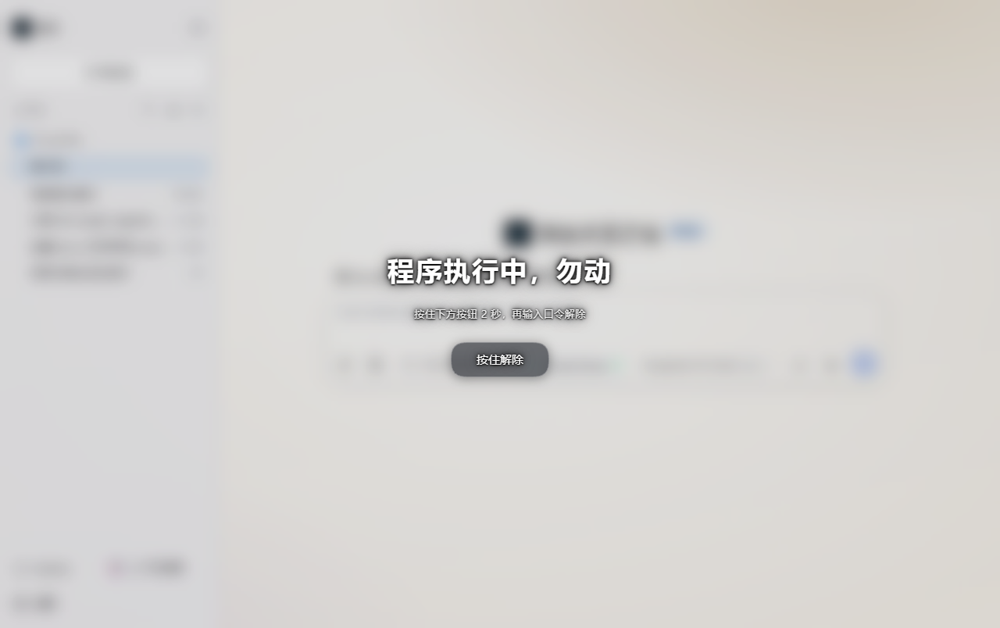
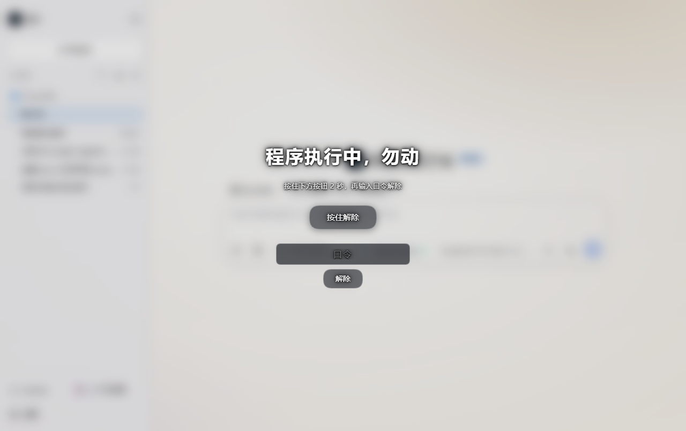
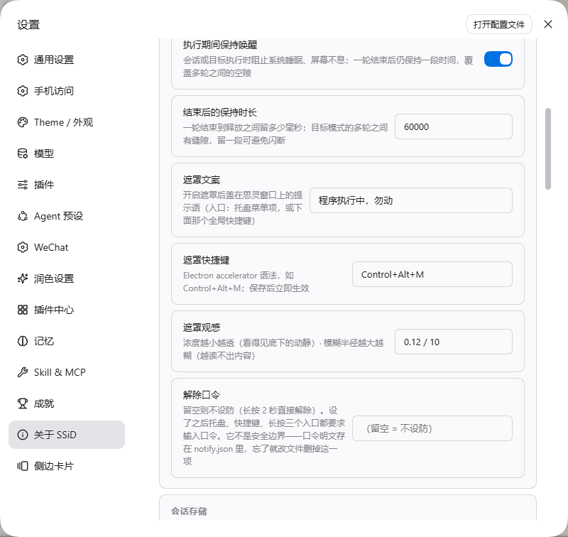

# 思灵（SSiD）· Seek Soul in Darkness

  

> **在黑暗中，寻找硅基生命的灵魂。**

SSiD 是 fractal 的 **DSH 基座版**——基于 [DeepSeek Harness](https://github.com/deepseek-ai/deepseek-harness) 的桌面 AI 应用：在**官方 DSH 桌面端底座**上改壳、装插件，做成开箱即用的思灵。

## 一页总览

| 维度 | 内容 |
|---|---|
| 三代家底 | cc-gui（UI 资产）→ oc-plus（增强件）→ fractal（桌面 GUI）≈ **50 个功能** |
| 迁移结论 | 约 **70% DSH 原生覆盖**，增量收敛 **5 块**：壳能力 / 记忆 UI + Guardian / 四 agent / 14 技能 / 零散面板 |
| 迁移路线 | **M0** 闭环验证 → **M1** 记忆 UI → **M2** Guardian 状态 → **M3** 四 agent → **M4** 自研壳——2026-08 排的期，**已走完**；M4 那个自研壳又在 1.0.0 换成了官方桌面端底座的 fork（见「定位」） |
| 长期护栏 | ① **不改 DSH 源码**，只改壳与插件这两层 ② 跟随 DSH 版本迭代，而不是把内核锁在旧版 |

📄 **迁移期的设计文档**（2026-08 起点）：[技术设计方案](docs/设计/SSiD-技术设计方案.md) · [迁移对照表](docs/设计/2026-08-16-三代资产完整迁移对照表.md) · [路线图](docs/设计/2026-08-16-分阶段路线图.md)｜**品牌**：[品牌手册](docs/品牌/品牌手册.md)

## 名字

中文名 **思灵**，英文 **Seek Soul in Darkness**，缩写 **SSiD**（中间的 `i` 小写）。

- **思（sī）** —— Si 的谐音＝硅，也是「思考 / 探寻」（Seek 的中文落点）。
- **灵（líng）** —— 灵魂，即 logo 里那只瞳孔的灵光。
- **Seek** —— 呼应 DeepSeek 的 Seek，SSiD 的基座正是 DeepSeek 的 DSH。
- **darkness** —— 三层：DeepSeek 鲸鱼 logo 游弋的深海；DS 无多模态、模型「看不见」；做 AI 本身就是在摸黑探路。
- **SSiD 里的 `i`** —— 那一点就是瞳孔，也是 Si（硅）。
- **彩蛋** —— SSiD 与 Wi-Fi 的 SSID 只差一个大小写；「在黑暗中寻找信号」与「连接」暗合。

完整品牌规范见 [`docs/品牌/品牌手册.md`](docs/品牌/品牌手册.md)。

## 定位

| 维度 | 说明 |
|---|---|
| 基座 | DeepSeek Harness（一切皆插件；**不改其源码**） |
| 形态 | **官方 DSH 桌面端底座的 fork**——内核随包进 `app.asar` 的 `dsh/`，Host 由官方的 `dsh-desktop-host` 担当，我们只做壳与插件这两层的改造 |
| 引擎 | DeepSeek 唯一 Provider |
| 版本线 | **两条独立**：思灵自己一个号（当前 `1.1.7`），随包内核一个号（当前 `0.2.0-rc.2`） |
| 与 fractal 关系 | fractal = OC 基座版（前身）；SSiD = DSH 基座版 |

## 技术栈

- **基座**：DeepSeek Harness——内核**随包**（`app.asar` 的 `dsh/`），不改源码；DSH 发新版就跟着走，而不是自己维护一套窗口层
- **壳**：官方桌面端基座 + 我们的改造（源码在 [`ssid-desktop/`](ssid-desktop/README.md)，逐条改动见 [`SSID-CHANGES.md`](ssid-desktop/SSID-CHANGES.md)）。自建壳时代做出来、换代后逐项接线回来的执行期能力：保持唤醒、截图（含标注编辑）、执行中遮罩、原生通知、托盘菜单、CodeGraph 索引适配、自绘标题栏
- **插件**：随包插件集 **34 个 bundle**（其中 20 个是 `@max-null/*` 自制），首启由壳接进 profile——记忆与监督（`dsh-memory` / `dsh-guardian` / `dsh-habit`）、中文思考与文风、侧栏生态（`dsh-better-sidebar` 及扩展）、剧本杀、微信桥、CodeGraph MCP、Office / 视频 / Excel 面板

## 截图

| 执行中遮罩：看得见动静、读不出内容 | 解除口令：长按 2 秒后再输入 |
|---|---|
|  |  |

**设置位置：设置 → 关于 SSiD → 通知设置**（文案、模糊浓度、解除口令都可改，也能整个关掉）：

> **执行中遮罩**——会话或目标正在跑的时候，从托盘菜单（或按 `Control+Alt+M`）给窗口盖一层毛玻璃：**底下看得见有动静，但读不出内容**。离开电脑去吃饭时挂着正合适；期间同时阻止系统睡眠与息屏，跑完自动恢复。解除要长按 2 秒（防手滑），也可以再设一道口令。

## 现状

**最新版本：v1.1.7**（2026-10-08，[Release Notes](docs/release-notes-v1.1.7.md)）：新增预制插件「剧本杀」（`@max-null/dsh-jubensha` 0.1.0）——AI 坐 DM 位、也填满其余的椅子，一个人就能开局；随包插件各跟到最新；`dsh-better-sidebar` 补一个并发上传 rename 争用的有界重试修复。本版未改壳代码。

前面两个版本定下了当前的形态，值得单独点出：

- **v1.1.6**（[Notes](docs/release-notes-v1.1.6.md)）——思灵与**官方 DSH 桌面版可以同时运行**：userData 让到 `%APPDATA%\ssid-shell`、存储根隔离到 `storages-ssid`、协议改为 `ssid://`；跨会话记忆两边共用。安装器与卸载器也换成了思灵品牌。
- **v1.0.0**（[Notes](docs/release-notes-v1.0.0.md)）——**换代版**：桌面壳从自建壳（≤0.4.0）换成**官方 DSH 桌面端底座的 fork**，内核随包；产品版本自此与内核版本分成两条线。自建壳时代的 `shell/` 已归档在 tag `v0.4.0-selfbuilt`。

更早的版本（0.1.x 自研壳 + 侧栏生态、预置插件、14 技能包、会话存储隔离）见 [Releases](https://github.com/Max-Null/seek-soul-in-darkness/releases) 与 `docs/release-notes-v*.md`。

## 下载安装

> **系统要求**：Windows 10/11 x64；macOS 另有产物，边界见下。

- **v1.1.7 资产**（[Release 页](https://github.com/Max-Null/seek-soul-in-darkness/releases/tag/v1.1.7)）：
  - Windows：`ssid-1.1.7-win-x64-unsigned.exe`（NSIS 安装包，约 431 MB）
  - macOS：`ssid-1.1.7-mac-arm64-unsigned.dmg` / `.zip`（约 540 / 567 MB）
- **开箱即用**：内核与预制插件**随包**（首启由壳把插件集接进 profile），不需要装 Node / pnpm、不需要设任何环境变量
- **升级**：覆盖安装即可——会话、工作区、插件配置与跨会话记忆都保留
- **与官方 DSH 桌面版共存**：1.1.6 起两者各有自己的 userData、存储根、会话根与协议名，可以同时开着
- **校验**：`certutil -hashfile <文件> SHA256`（macOS 用 `shasum -a 256`）——以 Release 页上 GitHub 记录的 `digest` 为准
- 全部历史版本：[Releases](https://github.com/Max-Null/seek-soul-in-darkness/releases)

> **关于签名**：本项目为开源免费软件，安装包**未做代码签名**（无费用）。Windows 首次运行可能提示「未知发布者 / 已保护你的电脑」——属正常安全提示，按下节放行即可。

> **macOS 通道的边界**：这条通道目前只验证到「CI 在真 mac 上打包成功、每个内嵌二进制都有签名」，**尚未在真机双击验证过**。产物是 ad-hoc 签名、未公证，Gatekeeper 会拦（右键打开，或先 `xattr -dr com.apple.quarantine 思灵.app`）。它证明的是**打包链通了**，不等于「mac 版已可用」——你在真机上试出来的结果，欢迎开 issue 反馈。

**Windows SmartScreen 放行三步**（首次安装遇到拦截图时）：

1. 右键安装包 → 属性 → 若勾选「解除锁定」则打勾 → 确定；
2. 仍被拦就在弹窗点「更多信息」→「仍要运行」；
3. 或右键「以管理员身份运行」。

## 路线图

- **版本历史与发版说明**：[Releases](https://github.com/Max-Null/seek-soul-in-darkness/releases) 与 [`docs/release-notes-v*.md`](docs/)
- **开发规范**：[`docs/SSiD开发手册.md`](docs/SSiD开发手册.md)——铁律速查、环境流转、插件升级、发版流程、踩过的坑
- **迁移期设计文档**（2026-08 起点）：[`docs/设计/`](docs/设计/)；历史决策与执行记录：[`docs/决策/`](docs/决策/)

## License

[MIT](LICENSE)
